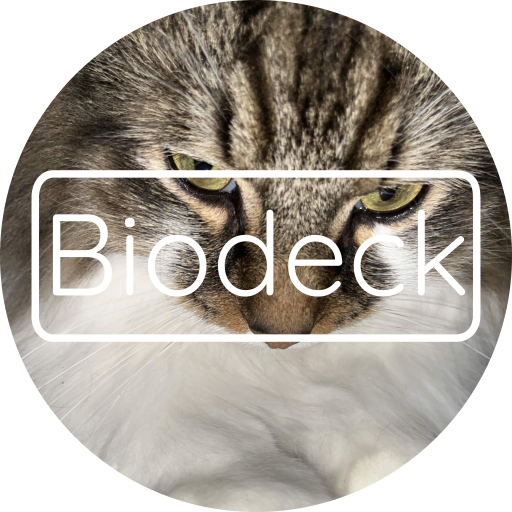

<h1>

</h1>

Biodeck is a kewl website. idek wat to explain

## wat et use
- nodejs
- express
- html5
- css3
- uhh

## how thig worke
- ``server.js``: whole seber (idk wy onogen no wan multipl files bu waever)
- ``403.html`` - ``503.html``: error pages
- ``other html files``: html files
- ``public``: public folder
    - ``uploads``: wher uploaded thig go
    - ``v86``: v86 code thig idk

