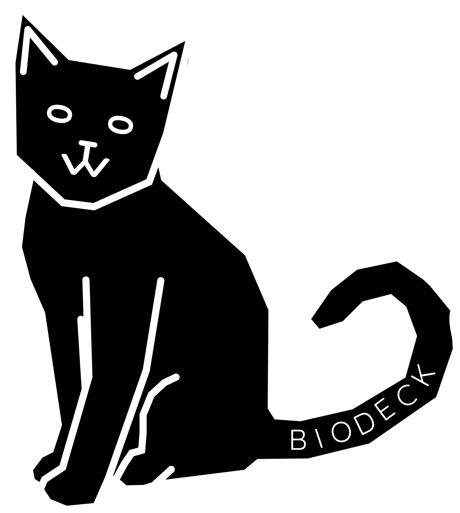

<h1>

</h1>

Biodeck is a kewl website. idek wat to explain

## What it uses
- nodejs
- express
- html5
- css3
- sqlite3
- dotenv
- nodemailer

## how thig worke
- ``server.js``: Server
- ``html files``: HTML files
- ``vars.env``: Environment variables (for nodemailer, rename vars.env.public to vars.env and put your info in it)
- ``activation-pings.txt``: Users that will be pinged on user creation (When registration gate is on)
- ``public``: Public folder
    - ``uploads``: Uploads
    - ``v86``: v86
